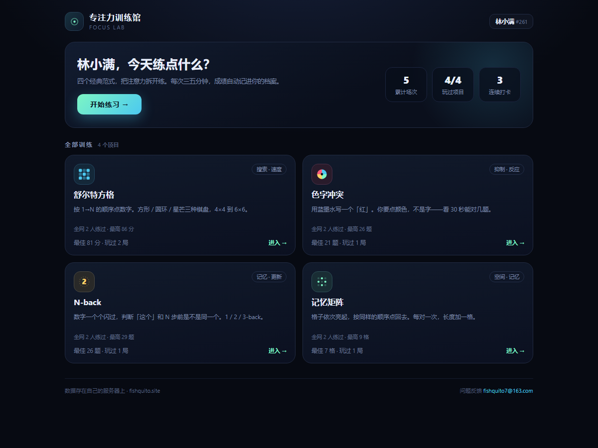
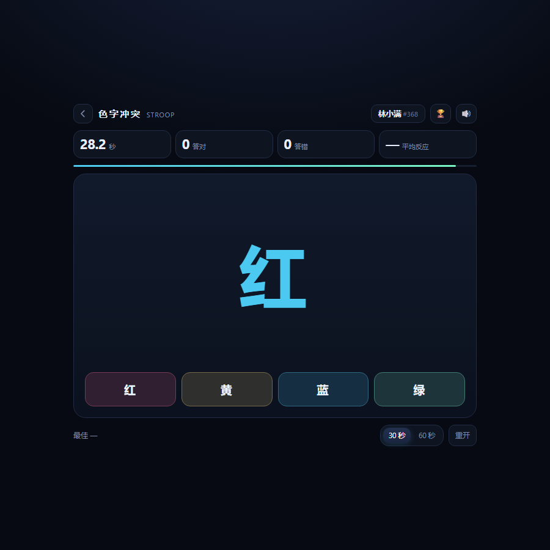
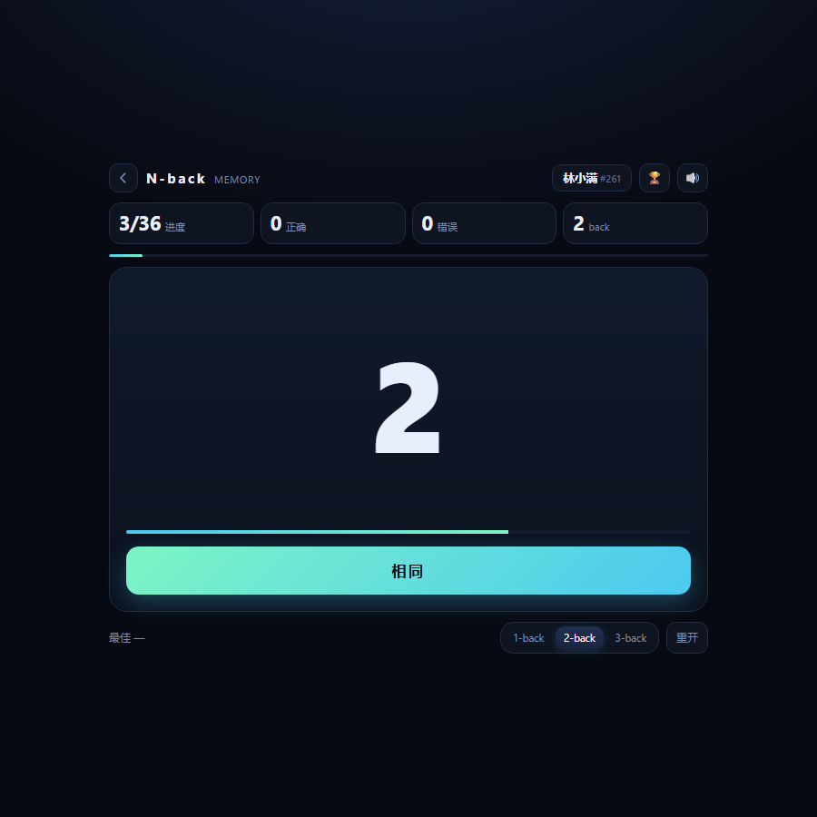
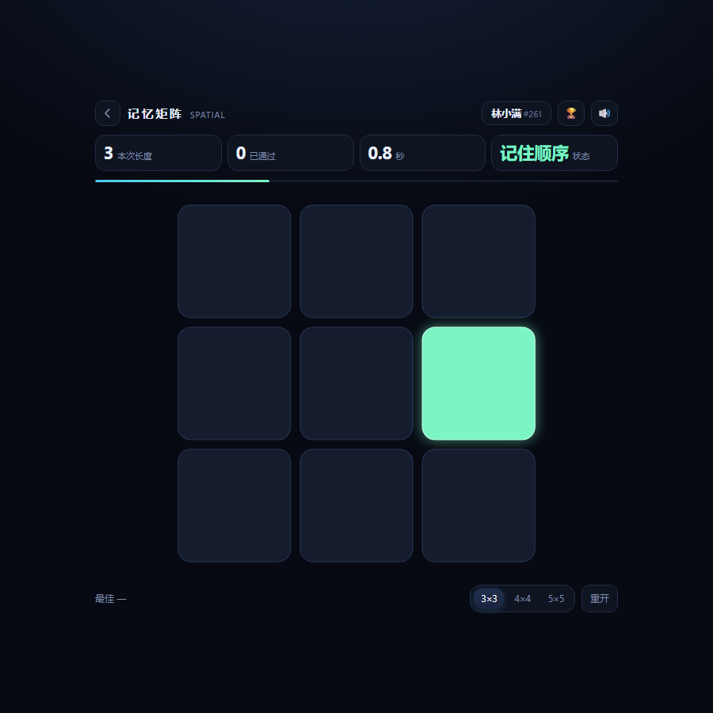
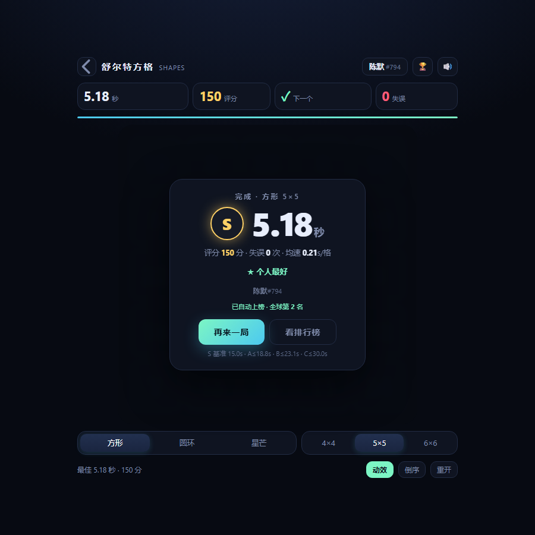
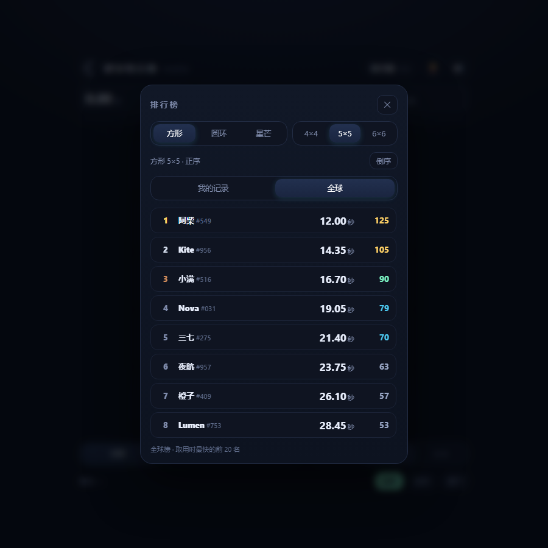

# 专注力训练馆

一个点开就玩、零依赖、前后端同源的小站。四个小游戏分别练注意力的不同侧面，
共用一套档案、成绩和排行榜。

在线试玩：**https://fishquito.site**



## 四个项目

| 游戏 | 练什么 | 一局多长 | 怎么算赢 |
|---|---|---|---|
| **舒尔特方格** | 视觉搜索、眼跳 | 15–30 秒 | 用时越短越好 |
| **色字冲突** | 抑制控制、选择性注意 | 30 / 60 秒 | 答对越多越好 |
| **N-back** | 工作记忆的持续更新 | 约 60 秒 | 答对越多越好 |
| **记忆矩阵** | 视空间短时记忆 | 1–3 分钟 | 连续记住越长的序列越好 |

前三个是「有始有终」的一局，记忆矩阵是「一直加到你记不住为止」。

## 目录结构

```
deployment/               上线用的东西都在这
  index.html              大厅：四张卡片 + 我的数据
  schulte/index.html      舒尔特方格
  stroop/index.html       色字冲突
  nback/index.html        N-back
  memory/index.html       记忆矩阵
  shared/core.css         共享样式：变量 / 控件 / 弹窗 / 排行榜 / 档案
  shared/core.js          共享逻辑：档案 / 后端 / 本机记录 / 音效 / 排行榜 / 倒计时
  server/                 零依赖 Node 后端（同时托管静态文件）
    server.js             入口：起服务 / 静态托管 / 档案接口 / 按游戏分发
    games/<id>/           每个游戏一个模块：榜单维度、校验、排序
    data/<id>.json        每个游戏一个数据文件（运行时生成，不进仓库）
  ops/                    运维层：TLS 前端 / 隧道 / systemd / logrotate
assets/                   截图
```

**多页，不是单页。** 每个游戏是独立 HTML，共用 `shared/`。这样每个游戏有自己的地址
（`/stroop/`）、自己的标题、可以单独分享，一个游戏改坏了也不影响别的。

## 舒尔特方格

从 **1** 开始按顺序点到最后一个数字，点错一次 **+1 秒罚时**，3-2-1 倒计时结束后计时才开始。

| 棋盘 | 说明 |
|---|---|
| **方形** | 标准舒尔特方格，行列有对齐线索，最省力 |
| **圆环** | 同心环 + 扇区。半径按 `r_k = R·√(累计格数/总格数)` 分布，保证每格面积相等；每一圈以不同角速度、不同方向缓慢自转，数字始终保持竖直 |
| **星芒** | 五角星轮廓 + Voronoi 碎块。先在单位圆里生成 Voronoi（圆是凸的，半平面裁剪才成立），再按角度把半径映射到星形边界；连续映射保证格子不会被切断。轮廓带凹角，视线没法一次扫完，难度最高 |

圆环每圈转速：`[中心 0°, 内环 +6°/s, 中环 −4.2°/s, 外环 +3.1°/s]`。右下角「动效」开关可以关掉转动。


## 色字冲突

屏幕上是一个用**别的颜色**写的颜色词（比如蓝色的「红」），下面四个色块按钮。
你要点**墨水的颜色**，不是字面意思——大脑读字是自动的，抑制它要花力气。



- 30 秒或 60 秒计时，答对 +1，答错不扣分但会**锁 300ms**，防止连点蒙对。
- 题目 72% 是冲突的（字义 ≠ 墨色），28% 是一致的——一致题会让你放松警惕，反而更容易在下一题上栽跟头。
- 四种颜色用的是站点主色系（红 / 黄 / 蓝 / 绿），刻意避开了「红绿对立」，在常见色觉异常下也能靠明度区分。
- 键盘 `1` `2` `3` `4` 可以直接作答。

**S 基准**：30 秒答对 **20 题**（平均 1.5 秒一题），60 秒 40 题。

## N-back

数字一个一个闪过（每个 1.6 秒），当前这个和 **n 步之前**那个一样，就点「相同」。



- 一局 36 个刺激，前 n 个是热身、不计分；计分题 = 36 − n。
- 30% 的题是匹配的，其余保证和 n 步前不撞车。
- 该按没按算错，不该按却按了也算错。
- 键盘 `空格` 直接按「相同」。

| 等级 | 计分题 | S 基准 | 体感 |
|---|---|---|---|
| 1-back | 35 | 32 题 | 大多数人都能过 |
| 2-back | 34 | 26 题 | 需要真的集中 |
| 3-back | 33 | 21 题 | 大多数人会崩 |

## 记忆矩阵

格子依次亮起，然后按**同样的顺序**点回去。对一次长度 +1，点错就结束。



- 3×3 / 4×4 / 5×5 三种棋盘，都从 3 格起步。
- 每格亮 430ms，间隔 170ms——太快没时间编码，太慢可以用复述硬扛。
- 成绩 = 成功复现过的最长序列长度。
- S 基准：3×3 连续 **7** 格，4×4 连续 **8** 格，5×5 连续 **9** 格。

## 评分

四个游戏用同一套换算，所以分数之间可以横向比较：

```
评分 = 基准 ÷ 实际 × 100      （舒尔特：基准是时间）
评分 = 实际 ÷ 基准 × 100      （其余三个：基准是答对题数）
                             上限都是 150
```

| 等级 | 条件 |
|---|---|
| S | ≥ 100（达到或超过基准线） |
| A | ≥ 80 |
| B | ≥ 65 |
| C | ≥ 50 |
| D | < 50 |

舒尔特的 S 级基准时间（秒）：

| | 4×4 | 5×5 | 6×6 |
|---|---|---|---|
| 方形 | 9 | **15** | 23 |
| 星芒 | 11 | 18 | 27 |
| 圆环 | 12 | 19 | 29 |

换算方式：每格约 0.6 秒（4×4 略快、6×6 略慢），星芒 ×1.2，圆环（自转）×1.27。
所以 5×5 方形 **15 秒以内才是 S**，30 秒只是 C，超过 30 秒就是 D。



## 排行榜与档案

排行榜按每个游戏的「变体」分榜：舒尔特 18 个（形状 × 尺寸 × 正序/倒序），
色字冲突 2 个（30 / 60 秒），N-back 3 个（1/2/3-back），记忆矩阵 3 个（棋盘大小）。

- **排序方向**：舒尔特按用时**升序**，其余三个按答对数**降序**；分数相同就比谁更快。
- **我的记录**：本机日志，每个榜最近 20 次，★ 标出个人最好。
- **全球榜**：每人每榜只有一条，只记个人最好；自己那行会高亮并标「我」。



第一次打开会让你起个名字，服务端同时生成一个 **9 位档案号**（前 3 位数字 + 后 6 位字母数字，
去掉了 `0/1/I/L/O/U` 这类易混字符），例如 `495MNTTE7`。

- **昵称**只是显示名，**允许重名**；榜上显示为 `小明#495` —— 昵称高亮，`#` 后三位是档案号前缀，灰色小字。
- **档案号**是唯一的钥匙。点右上角昵称打开「我的档案」，可以复制档案号或**同步链接**
  `https://fishquito.site/?id=495MNTTE7`，在手机上打开就自动接管同一份档案，进了大厅再挑游戏。
- 结算时自动跟你自己的最好成绩比：破了就直接覆盖你榜上那一行，不需要点按钮。

> 同步链接用的是「线上站点」地址：`shared/core.js` 里有个常量 `PUBLIC_BASE = 'https://fishquito.site'`，
> 本机（`127.0.0.1` / `file://`）调试时会自动用它，避免把回环地址发出去。换域名只改这一处。
>
> 本机记录存在 `focus.runs.v1`，键是 `游戏|变体|正序倒序`。老版本的 `schulte.lb.v3` 会在首次打开时自动迁移。

## 后端

自带一个零依赖 Node 后端（只用内置模块，`node >= 18`），放自己服务器上就行，不用数据库。
**一个进程，但每个游戏一个模块、一个数据文件**——档案是四个游戏共用的，成绩各存各的。

```bash
cd deployment/server
node server.js          # 默认 http://127.0.0.1:8090，同时把静态站点也托管了
```

打开 `http://127.0.0.1:8090/` 就是大厅，前后端同源，**不需要任何配置**。
部署（systemd / nginx / HTTPS / 环境变量）见 [`deployment/server/README.md`](deployment/server/README.md)，
运维层见 [`deployment/ops/README.md`](deployment/ops/README.md)。

站点由这台服务直接托管：`fishquito.site` → nginx → `127.0.0.1:8090`。
如果哪天要把前端挪到别处，把后端地址填进页面（或全局）即可，留空则自动探测同源 `/api/health`：

```js
window.FOCUS_NET = { base: 'https://api.example.com' };
```

探测不到后端时，「全球」页签不出现，完全退回本机模式。

## 加一个新游戏

1. 建 `新游戏/index.html`，引 `../shared/core.css` 和 `../shared/core.js`；
2. 页面里 `Core.mountTopbar({title, sub, onLB})` 出顶栏，`await Core.ready` 拿档案；
3. `Core.ui.countdown()` 做 3-2-1 开场，`Core.ui.overlay()` 出准备/结算面板；
4. 成绩用 `Core.api.post(...)` 上报、`Core.runs.*` 存本机，榜单用 `Core.lb.open({...})`；
5. 建 `deployment/server/games/新游戏/index.js`，照契约写 `cmp / parseBoard / parseScore`——
   加一个目录就等于上线，`server.js` 不用改；
6. 大厅 `index.html` 里加一张卡片。

## 本地运行

```bash
cd deployment/server && node server.js
# 打开 http://127.0.0.1:8090/
```

直接双击 `index.html`（`file://`）也能玩，只是没有全球榜——页面会跳过后端探测。

## 许可

MIT
